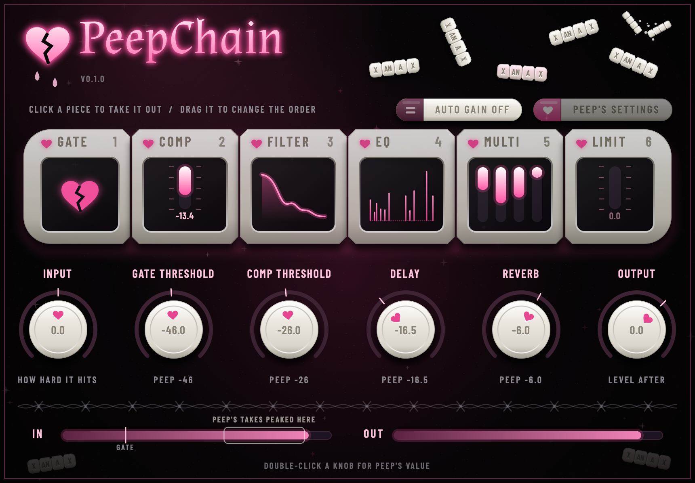

# PeepChain

**PeepChain** is Lil Peep's (Gustavo Elijah Fring) GarageBand vocal chain as a single VST3 plugin for Windows.

Every effect in his chain (Noise Gate, Compressor, Filter, Graphic EQ, Multiband Compressor, Peak Limiter, plus
his Delay and Reverb sends) has been carefully recreated from the GarageBand originals at his settings. Side by
side with GarageBand's own bounces, there's no audible difference. If you're on a Mac you already have this in
GarageBand; PeepChain is for everyone else.

**[Download](#install-windows)**

## How accurate is it?

Subtracting GarageBand's output from PeepChain's leaves almost nothing behind:

| | Difference from GarageBand | Leftover level |
| --- | --- | --- |
| Full chain, on the three vocals it was built from | 35–39 dB quieter than the vocal | about 1–2 % |
| Full chain, on a vocal it had never heard | 31 dB quieter | about 3 % |
| Delay | 57–60 dB quieter | about 0.1 % |
| Reverb | 91 dB quieter | under 0.01 % |

In other words, no audible difference. For scale, GarageBand itself varies by about as much: the same audio
through the same settings comes out about 32 dB different depending on which other effects are switched on.



## Hear it

The same vocal (one PeepChain was never tuned on) through GarageBand and through PeepChain, with the full chain
plus Delay and Reverb:

| Original (GarageBand) | Clone (PeepChain) |
| --- | --- |
| [▶ original.mp3](docs/example/original.mp3) | [▶ clone.mp3](docs/example/clone.mp3) |

## Controls

It opens on his preset. You can adjust:

- **Input** and **Output** level
- **Gate** and **Compressor** threshold
- **Delay** and **Reverb** amount
- each effect **on / off** (click it) and their **order** (drag it)
- **Auto Gain**, which keeps the volume the same when you bypass the plugin, so you hear the difference in sound
- **Reset to Peep** to go back to his settings

## Install (Windows)

1. Download `PeepChain-VST3-Windows.zip` from the [Releases](https://github.com/PeepChain/PeepChain/releases) page.
2. Unzip it and copy the `PeepChain.vst3` folder into `C:\Program Files\Common Files\VST3`.
3. Rescan plugins in your DAW.

## Building from source

Needs Git, CMake and a C++17 compiler. [JUCE](https://github.com/juce-framework/JUCE) 8.0.15 isn't included,
so it's cloned first:

```
git clone https://github.com/PeepChain/PeepChain.git
cd PeepChain
git clone --depth 1 --branch 8.0.15 https://github.com/juce-framework/JUCE.git third_party/JUCE
cmake -S . -B build
cmake --build build --config Release --target PeepChain_VST3
```

It should also build on Linux, but that hasn't been tested.

## License

The source code in this repository is under the [MIT License](LICENSE). The plugin is built with
[JUCE](https://juce.com), which is used under the [AGPLv3](https://www.gnu.org/licenses/agpl-3.0.html), so the
released plugin (`PeepChain.vst3`) as a whole is distributed under the AGPLv3.

## Credits

Built with [JUCE](https://juce.com). Fonts: Almendra by Ana Sanfelippo and Barlow Condensed by The Barlow
Project Authors, both under the SIL Open Font License. Not affiliated with Apple, Lil Peep or his estate.
GarageBand is a trademark of Apple Inc.
